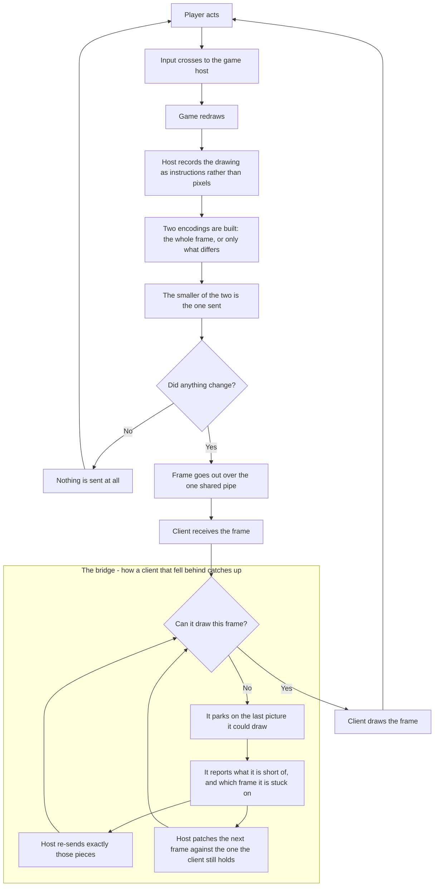

# The smart path, end to end

How a keypress becomes a picture on screen. Kept high level on purpose: the
detail lives in the code, this is the shape of it.

Open work is in [tasks.md](tasks.md).

## The bridge

It is the only way a stuck client gets unstuck, and it has **two routes** because
a client can be behind in two different ways:

- **Short of artwork** - it names the pieces and the host re-sends just those.
- **Holding a stale baseline** - it still has an older frame, so the host patches
  the *next* frame against that one instead of the previous one. It catches up in
  a single step instead of replaying everything it missed.

Both routes return to the same question, so the client keeps asking until the
answer is yes. Until then the screen shows the last picture it could draw - a
deliberate freeze, not a stall.

## The rest, briefly

**Two encodings per frame.** A whole frame and a patch are both built and
compressed, and the smaller is sent. Nothing picks a mode in advance. The patch
can reach back sixty frames, which is what makes the second bridge route possible.

**Silence is normal.** Nothing changed means nothing is sent, and the link goes
completely quiet. The downlink used to carry a bare ping at 16 ms whenever the
encoder had nothing to say, on the theory that an idle radio falls asleep; a
controlled twelve-run matrix found no effect of it on any metric larger than the
run-to-run spread, so it was removed. What it did do is covered under the known
costs below.

**Artwork is the whole story.** Drawing instructions are about 1% of the bytes.
Anything about bandwidth, stutter or spikes is really a question about artwork.

## Buffers, and whose they are

| where | whose | fills when | symptom |
|---|---|---|---|
| send buffer | the connection library's | the network is slower than we produce | frames wait behind an artwork burst |
| artwork waiting list | ours | artwork is queued faster than the budget allows | a piece the current view needs waits behind speculative ones |
| client holding a frame | the client's | the frame needs artwork it doesn't have | a visible freeze on a new view |

Frames skip the throttle entirely and go straight into the send buffer, so our own
throttling never holds a frame up. But frames share that buffer with artwork, and
artwork is almost all of it - which is why a burst of artwork can still delay
frames. Not our queue; the shared buffer underneath it.

## Known costs

- **Every new client is handed the entire artwork cache** before anyone knows what
  it needs. The most likely source of the send buffer's worst spike.
- **Artwork repeats are a real share of the traffic.** An earlier note said 44%;
  the counter in the interposer's own stats read `TEX_repeat=3653` of `22636`
  sends (16%) on the session this document was last checked against, with
  `WIRE_kb=43432` of draw-command traffic against `TEX_kb=38857` of artwork. Both
  numbers come from the same run and are printed together, so re-read them rather
  than trusting either figure.
- **An idle link really does go quiet, and that was measured rather than
  assumed.** With the keepalive on, the longest the host went without sending on
  an idle link was 30 ms; with it off, 1002 ms. The question that matters is not
  how long the silence is but whether the frame after it still arrives promptly,
  and it does: a client parked on the pause menu for 120 s drew the next change
  1.1 ms after the frame reached it, against 3.7 ms with no idle period in front
  of it (`scripts/df_idle_probe.mjs`). That probe now launches with the same
  hardware-GL arguments as the bench and refuses to run when the page reports a
  software renderer: it produced a latency claim, and a latency measured through
  the rasteriser is a measurement of the rasteriser. WebRTC's own consent checks keep the
  connection up; nothing about the stretch of silence is visible to the player.
- **The channel is partially reliable, and there is a ceiling where that starts
  to cost something.** The client creates `df-stream` with
  `{ordered: true, maxRetransmits: 0}`, and the host reports the same thing back
  from `rtc::DataChannel::reliability()` — ordered, no retransmission. A message
  that is lost on the wire is therefore permanently lost and repaired by the next
  delta or a keyframe, not by SCTP. Measured with a controlled offer
  (`scripts/df_load_probe.mjs`, `evidence/bench/FRAME_LOSS.md`), the path carries
  3655 messages a second of 256 B and 5.8 MB/s of 4 KB messages with nothing lost
  at all, and starts losing a few tenths of a percent above roughly **4000
  messages a second or 5.5 MB/s, whichever binds first** — at which point SCTP
  also begins refusing sends, and what it refuses is queued rather than dropped.
  On loopback every one of those offers is delivered whole, so the ceiling is the
  radio. This path's steady state is ~52 messages a second and 0.03 MB/s, two
  orders of magnitude below the smallest offer tested.

## Where the numbers come from

Two counters are the whole bench's foundation, and both are taken at a send call
rather than estimated:

- **Draw-command traffic** — every byte handed to the client's data channel,
  frames and artwork alike, counted in the interposer and served as JSON at
  `http://<host>:8484/df-stats`.
- **Whole-picture traffic** — every byte handed to a viewer's HTTP response by the
  relay, counted in `server/features/raw/raw_controller.go` and served at
  `http://<host>:8000/raw-stats`.

The bench itself is described in [bench.md](bench.md).

